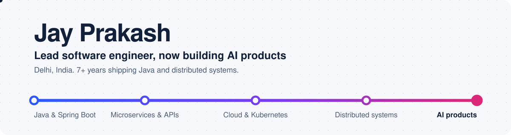
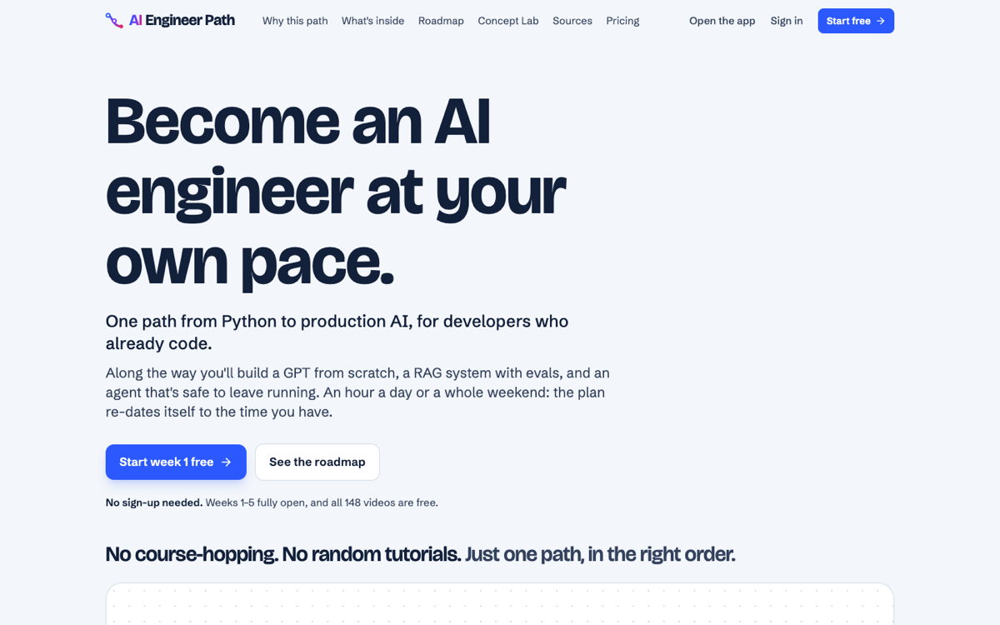
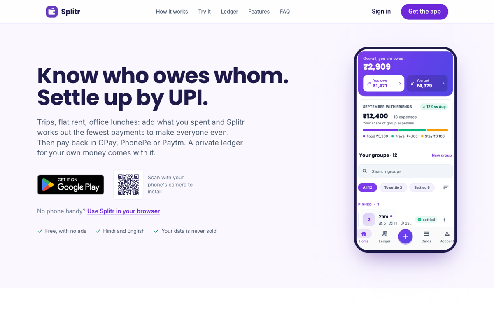
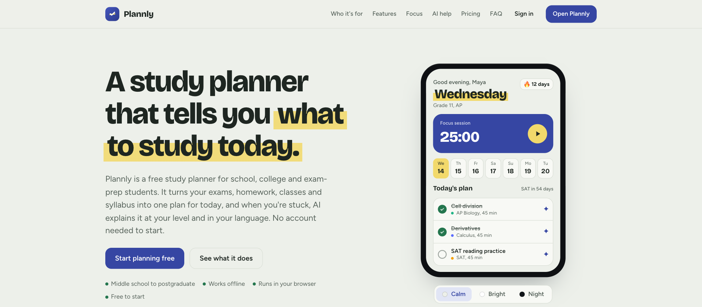
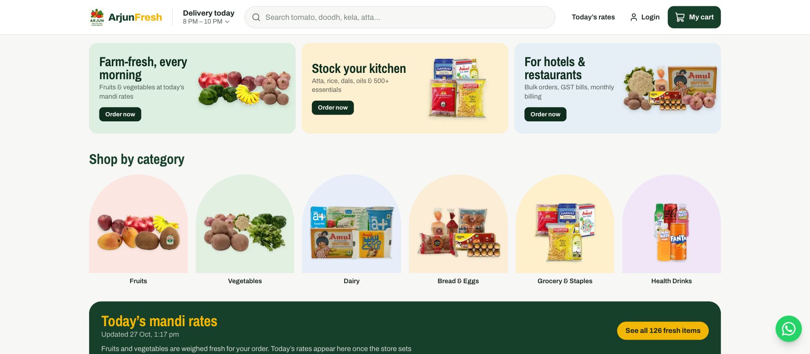

<picture>
  <source media="(prefers-color-scheme: dark)" srcset="assets/banner-dark.svg">
  
</picture>

I'm a lead software engineer with 7+ years of building backend systems in **Java and Spring Boot**: microservices, API platforms, cloud deployments and the distributed systems behind them. These days I take that production discipline into **AI products**, and I build my own apps under **Jay Apps Studio**.

## What I've built

### [AI Engineer Path](https://aiengineerpath.in) · live

Become an AI engineer at your own pace. One 40-week path from Python to production AI, for developers who already code: along the way you build a GPT from scratch, a RAG system with evals, and an agent that's safe to leave running.

- **247 original lessons** across 8 phases, **22 interactive simulations** (self-attention, gradient descent, temperature and top-p, a RAG pipeline…), and a quiz, exercises and interview questions for every week
- **Eight portfolio projects**, with two flagships that ship eval results and a cost analysis: a production RAG system with hybrid search and reranking, and a LangGraph agent with approval gates, a cost ceiling and its own MCP server
- A **pace engine** that re-dates 280 daily tasks to the hours each learner has, with progress synced across devices
- **148 free videos** from StatQuest, Andrej Karpathy, 3Blue1Brown and others, each placed on the week it helps. Weeks 1–5 are open with no sign-up
- **Next.js 16 on Cloudflare Workers**, Supabase for auth and data, Resend email and Turnstile spam protection

### [Splitr](https://splitr.in) · live on the web, Android app in closed testing

Know who owes whom, and settle up by UPI. Add what you spent on a trip, the flat rent or office lunches; Splitr works out the fewest payments to make everyone even, then opens GPay, PhonePe or Paytm to pay back. A private personal ledger keeps track of your own money alongside.

- **Android app in Flutter** that works offline: writes queue on the phone and sync with idempotency keys, so nothing is saved twice. UPI deep links, Google sign-in, push notifications, Hindi and English
- **Personal ledger** with a monthly summary, category breakdown, budgets and a savings goal, and no bank login
- Splitwise import with original dates, receipt scanning, 25 currencies, and group chat over WebSockets
- **TypeScript (React and Express) on PostgreSQL**, deployed with Docker Compose and Caddy; each deploy runs migrations first and rolls back automatically if the health check fails

### [Plannly](https://plannly.org) · live

A free study planner that tells you what to study today. For school, college and exam-prep students in any country: it turns exams, homework, classes and the syllabus into one daily plan, and when you're stuck, AI explains it at your grade and in your language.

- **A plan that fits the days you have**: syllabus topics spread across the days before the exam, important ones first, with revision days kept at the end. It adjusts to how fast you actually work
- **Spaced repetition** for revision, and flashcards on the same SM-2 schedule Anki uses, with Learn, Test and Match modes
- **AI study help** with Claude: topics pulled from your curriculum, step-by-step answers from a photo of a question, and notes, flashcards and a quiz made from a lecture PDF
- Attendance tracking, mock-test trends, GPA and CGPA, a focus timer and Android home-screen widgets
- **Offline-first Flutter app** (data stays on the device). The backend is **Spring Boot 3** with PostgreSQL, Redis, JWT auth and the Anthropic Java SDK, deployed with Docker Compose and Caddy; the website runs on Cloudflare Pages

### [Arjun Fresh](https://arjunfresh.com) · live on the web, Android and iPhone apps coming

Online ordering for a neighbourhood fruit and vegetable store in Delhi, which until now took orders over WhatsApp. One Supabase backend runs the website, an Android and iPhone app, and the store's admin panel, for households as well as hotels and restaurants.

- **Prices are worked out on the server**: a Postgres `place_order` function re-prices every line and checks stock, delivery slot cut-off, pincode, coupons and credit limits. Fresh produce follows the owner's **daily mandi rates**; items without a rate today are weighed and priced at packing, and the customer sees the final bill update live
- **Delivery built in**: map pin and delivery radius on OpenStreetMap, fees by distance, rider runs, and **live delivery tracking** from a rider page that needs no login
- **Flexible checkout**: cash or UPI on delivery, online payment verified on the server, or monthly credit for business customers, with a limit and a running ledger
- **Admin panel** with owner and staff roles, Web Push alerts for new orders, sales insights, and search that understands local names (*doodh*, *kela*, *atta*) across about 800 products
- **Next.js 16 on Cloudflare Workers**, an **Expo** app for Android and iOS, and **Supabase** with row-level security. Migrations are tested on an in-memory Postgres, with GitHub Actions checks and nightly database backups

## Engineering projects

| Project | What it shows |
| --- | --- |
| [event-ledger](https://github.com/jay-prakash96/event-ledger) | Two FastAPI microservices that process financial events with **idempotency**, **out-of-order tolerance**, a hand-written **3-state circuit breaker** and **distributed tracing**, all in Docker Compose |
| [quick-pick](https://github.com/jay-prakash96/quick-pick) | An AI-assisted HR recruitment platform split into **microservices**: user management, job management, and resume parsing with candidate services |
| [algo-trader](https://github.com/jay-prakash96/algo-trader) | Full-stack trading workspace on **Zerodha Kite Connect**: FastAPI backend, Next.js frontend, live strategy charts, PnL and a strategy worker |
| [important-design-pattern](https://github.com/jay-prakash96/important-design-pattern) | **Gang of Four patterns in Spring Boot**, taken all the way to **AWS EKS** with Jenkins, Docker and Kubernetes CI/CD |

## Apps in progress

- **Guard**: a scam checker app built with **Flutter** and a **Firebase** backend
- **Freelio**: a self-hosted business platform for freelancers, covering invoices, expenses, contracts, clients, projects, tax and an **AI assistant** (Next.js, Prisma)
- **RecurraDoc**: AI document automation; upload a template, let AI find the variables, and generate finished documents in about a minute

These repositories, and the ones behind the products above, are private. Happy to walk through any of them.

## How I work

- **Backend:** Java, Spring Boot, microservices, REST API platforms, Python and FastAPI, Node and TypeScript
- **Data:** PostgreSQL, Supabase, SQLite, Prisma, SQLAlchemy, Firebase
- **Cloud and delivery:** AWS EKS, Kubernetes, Docker, Jenkins, Cloudflare Workers, Caddy
- **Frontend and mobile:** Next.js, React, Tailwind CSS, Flutter, Expo (React Native)
- **AI:** LLM features in production apps, RAG, evals and agents, and teaching all of it on AI Engineer Path

## Always learning

Repos I'm working through (forks): [hands-on AI engineer notebooks](https://github.com/jay-prakash96/ai-engineer-notebooks), the [system design primer](https://github.com/jay-prakash96/system-design-primer) and [interactive coding challenges](https://github.com/jay-prakash96/interactive-coding-challenges).

## Get in touch

[LinkedIn](https://www.linkedin.com/in/jay-prakash-331697116/), or try one of the apps above. I'm always glad to talk about backend systems, AI products, or what you're building.
